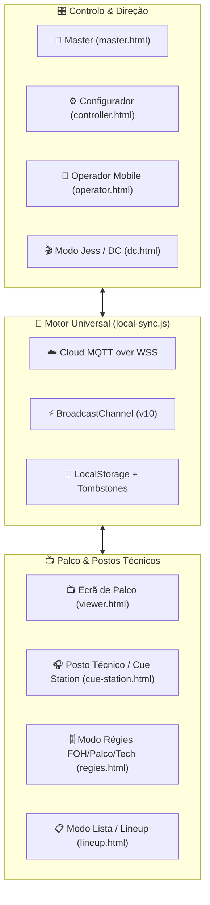

# 📘 Livro de Regras — StageTimer PFP (Arquitetura, Desenvolvimento e Operação)

Bem-vindo ao **Livro de Regras Oficial do StageTimer PFP**.
Este documento estabelece as normas técnicas, funcionais e de interface para garantir que qualquer evolução do sistema mantém **100% de estabilidade em espetáculos ao vivo**, sem quebrar a sincronização entre palcos, régies, direção de cena e ecrãs de palco.

> **Nota para Agentes de IA (Antigravity):** As regras executáveis deste documento estão também espelhadas em [AGENTS.md](AGENTS.md) na raiz do projeto, sendo carregadas automaticamente em todas as sessões.

---

## 🧭 1. Visão Geral da Arquitetura

O **StageTimer PFP** funciona numa arquitetura **Dual-Runtime**:
1. **Modo Cloud / Estático (Produção — Netlify / PWA)**: Corre 100% no browser a partir da diretoria `public/`, sincronizando múltiplos dispositivos em tempo real via **MQTT over WSS**, **BroadcastChannel** (entre abas do mesmo dispositivo) e **localStorage** (persistência offline).
2. **Modo Servidor Local ([server.js](server.js))**: Servidor Node.js + Express + WebSocket (`ws`) para redes locais fechadas sem internet.



---

## 🛡️ 2. As Regras de Ouro (Inquebráveis)

### Regra #0 — Consentimento Prévio Obrigatório (Regra Máxima)
Nenhuma alteração, criação, edição ou eliminação de ficheiros de código, estilos ou configuração pode ser executada sem:
1. Apresentar uma explicação clara do que precisa de ser feito e porquê.
2. Apresentar o plano detalhado e os ficheiros afetados.
3. Aguardar e obter o **consentimento explícito do utilizador** antes de mexer em qualquer ficheiro.

### Regra #0.1 — Commit Git Automático e Autónomo
Assim que qualquer conjunto de alterações for autorizado e concluído, o agente ou programador deve **executar de imediato um commit no Git de forma 100% autónoma** (sem pedir confirmação para o commit em si), garantindo um histórico limpo e rastreável de todas as modificações (`docs:`, `fix:`, `feat:`).

### Regra #1 — Nunca Depender Exclusivamente do Backend Node.js
Toda a funcionalidade nova (timers, cues de teatro, checklists, relatórios, importadores, controlo remoto de ecrãs) **tem de ser implementada no cliente** (em [public/js/local-sync.js](public/js/local-sync.js) e nos respetivos scripts de página) para funcionar no deploy estático do Netlify ([netlify.toml](netlify.toml)).

### Regra #2 — Zero Dados Demo ("Clean Slate")
- Nenhum evento ou sala nova pode nascer com bandas ou timers pré-preenchidos.
- Uma sala nova começa sempre com `timers: []` (0 itens).
- Eventos apagados são registados em `stagetimer_v63_deleted` (tombstones) e **nunca** podem ressuscitar através de mensagens MQTT antigas retidas no broker.

### Regra #3 — Isolamento Absoluto entre Salas/Palcos (`cleanRoom`)
- Cada sala/palco tem o seu próprio tópico MQTT (`stagetimer_v10/<ROOM>/state`), canal local (`stagetimer_v10_<ROOM>`) e chave de armazenamento (`stagetimer_v10_state_<ROOM>`).
- A resolução do código da sala segue estritamente a ordem:
  1. Query string `?room=CODIGO` na URL
  2. `sessionStorage.getItem('stagetimer_active_room')`
  3. `localStorage.getItem('stagetimer_device_room')`
  4. `localStorage.getItem('stagetimer_last_room')`
  5. Fallback padrão: `'PALCO1'`

### Regra #4 — Retrocompatibilidade do Esquema de Estado (`state`)
Qualquer ecrã pode ler `client.state`. O objeto de estado de uma sala tem de manter sempre a seguinte estrutura base intacta:

```javascript
{
  id: "PALCO1",                  // Código normalizado da sala
  name: "Palco Principal",       // Nome amigável do evento/palco
  activeDayId: "day_1",          // ID do dia ativo
  days: [                        // Suporte multi-dia
    { id: "day_1", name: "Dia 1", date: "", timers: [...] }
  ],
  activeTimerId: "...",          // ID do timer atualmente ON AIR no palco
  message: {                     // Mensagem / Prompter enviado para o palco
    text: "",
    visible: false,
    urgent: false,
    color: "yellow"
  },
  timers: [...],                 // Espelho sincronizado dos timers do dia ativo
  theatre: {                     // Dados do Modo Jess (DC) & Cue Station
    showStatus: "idle",          // 'idle' | 'running' | 'paused' | 'ended'
    scriptLines: [...],
    cues: [...],
    checklists: [...],
    telemetry: [...],
    savedReports: [...]
  }
}
```

### Regra #5 — Preservação de Identidade e Autenticação em Resets
Sempre que existir uma limpeza de época (`CLEAN_SLATE_EPOCH`), reset de cache ou comando remoto de reload, as seguintes chaves do `localStorage` / `sessionStorage` **são sagradas e nunca podem ser apagadas** (exceto em logout explícito):
- `stagetimer_device_uuid` e `stagetimer_screen_uuid`
- `stagetimer_master_active`
- `stagetimer_master_auth_v12`
- `stagetimer_auth_unlocked`

### Regra #6 — Sincronização de Hora Real (`TrueTime`)
Em espetáculos ao vivo, diferentes telemóveis, tablets e PCs podem ter os seus relógios internos desfasados em vários segundos.
- Todos os cálculos de tempo decorrido (`elapsed`), contagem decrescente e relógio de parede devem usar `UniversalSyncClient.globalTrueTime()` / `client.getTrueTime()`, que compensa automaticamente o offset (`window._stagetimer_time_offset`) sincronizado por HTTP `Date` header.

### Regra #7 — Cache-Busting e Service Worker (`sw.js`)
Para garantir que nenhum iPad ou computador de régie fica preso numa versão antiga em cache:
1. Sempre que editar um ficheiro `.js` ou `.css`, atualize o sufixo `?v=XX` nos ficheiros `.html` que o importam.
2. Atualize a constante `CACHE_NAME` no topo de [public/sw.js](public/sw.js) (ex.: de `stagetimer-pfp-v93` para `stagetimer-pfp-v94`).

---

## 🎭 3. Regras por Módulo Funcional

### 3.1. Modo Jess — Diretora de Cena ([dc.html](public/dc.html) / [dc.js](public/js/dc.js)) & Posto Técnico ([cue-station.html](public/cue-station.html) / [cue-station.js](public/js/cue-station.js))
- **Fluxo de Estados de Cue**:
  - `idle` (Aguardar) ➔ `standby` (Prevenir / Amarelo) ➔ `go` (Disparo / Verde) ➔ `acked` (Confirmado pelo técnico com cálculo de latência `ackLatencyMs`).
- **Departamentos Suportados**: `Som`, `Luz`, `Vídeo`, `Palco`, `Pirotecnia`, `Todos` (ou departamentos personalizados).
- **Checklists Pré-Show**:
  - Tarefas podem ser normais (recorrentes em todas as sessões, resetáveis para a próxima sessão) ou **Pontuais (`oneOff: true`)**.
  - A barra de prontidão global (0%–100%) reflete em tempo real as validações feitas tanto pela Diretora de Cena como pelos Postos Técnicos.
- **Telemetria e Relatórios**:
  - Cada ação (`SHOW_START`, `SHOW_PAUSE`, `SHOW_END`, `CUE_STANDBY`, `CUE_GO`, `CUE_ACK`, `URGENT_MSG`) gera uma entrada em `state.theatre.telemetry`.
  - No fim do espetáculo, é possível guardar snapshots completos em `state.theatre.savedReports` e consultá-los em modal ou descarregar em `.txt`.

### 3.2. Super Régie Master ([master.html](public/master.html) / [master.js](public/js/master.js))
- Permite visualizar todos os eventos/palcos registados e todos os dispositivos online (`_global_presence`).
- **Controlo Remoto de Dispositivos**:
  - O Master pode enviar comandos instantâneos (`set-view`, `set-room`, `reload`, `identify`) para um dispositivo específico (`stagetimer_v10/_cmd/<deviceUuid>`), para uma sala inteira (`_cmd_room/<room>`) ou para todos os dispositivos (`_cmd_all`).
  - Qualquer novo ecrã adicionado ao projeto **tem de ser registado** em `_getCurrentViewKey()` e `_getDeviceLabel()` dentro de [public/js/local-sync.js](public/js/local-sync.js#L175-L218) para aparecer corretamente no painel Master.

### 3.3. Importadores ([schedule-importer.js](public/js/schedule-importer.js) & [theatre-importer.js](public/js/theatre-importer.js))
- O importador de horários e o importador de guiões/cues de teatro devem ser tolerantes a múltiplos formatos de texto/CSV/tabelas coladas do Excel ou Word, convertendo durações (`5:00`, `1h30`, `45m`) e horários (`21:30 - 22:15`) sem lançar exceções que bloqueiem a UI.

---

## 📱 4. Normas de Interface, Mobile & iOS PWA

1. **Zero Overflow Horizontal**:
   - `overflow-x: hidden` e `max-width: 100vw` são obrigatórios.
   - Em ecrãs pequenos (iPhone SE / iPhone 15 Pro), grelhas e barras de botões devem usar `flex-wrap: wrap` ou scroll horizontal interno contido, nunca alargando o `body`.
2. **Inputs em iOS Safari**:
   - Qualquer `<input>`, `<select>` ou `<textarea>` deve ter `font-size: 16px` (ou `1rem` quando `html { font-size: 16px }`) para impedir que o iOS faça zoom automático ao focar no campo.
3. **Semáforo Visual de Palco**:
   - **Verde (`--green: #00b894`)**: Tempo normal em curso.
   - **Amarelo (`--yellow: #fdcb6e`)**: Aviso (`warnAt` atingido ou `STANDBY`).
   - **Vermelho (`--red: #e17055` / `--danger: #ff4757`)**: Perigo (`dangerAt` atingido, tempo esgotado ou aviso urgente).
4. **Tipografia**:
   - Texto e UI geral: `var(--font-sans)` (`Inter`).
   - Relógios, contadores, códigos de sala e latências: `var(--font-mono)` (`JetBrains Mono`) com números tabulares para evitar trepidação visual a cada segundo.

---

## 🔐 5. Credenciais e Controlo de Acesso ([public/js/auth.js](public/js/auth.js))

| Nível de Acesso | Ecrãs Protegidos | Passwords Aceites | Chave de Sessão |
| :--- | :--- | :--- | :--- |
| **Público / Visualização** | `index.html`, `viewer.html`, `lineup.html`, `cue-station.html` | Sem password (acesso rápido de palco/técnico) | — |
| **Operação / Controlo** | `controller.html`, `operator.html`, `dc.html`, `regies.html` | `1379`, `brito`, `1379brito` | `stagetimer_auth_unlocked = 'true'` |
| **Super Régie Master** | `master.html` (e desbloqueia todos os restantes) | `1379brito` (também aceita `1379` / `brito`) | `stagetimer_master_active = '1'`, `stagetimer_master_auth_v12 = 'true'` |

---

## 🧪 6. Protocolo de Verificação Antes de Deploy

Antes de dar qualquer alteração como concluída ou correr [deploy.ps1](deploy.ps1):

1. **Testar Sincronização Entre Abas**: Abrir duas abas no mesmo `room` (ex.: `dc.html?room=TESTE` e `cue-station.html?room=TESTE`, ou `controller.html?room=TESTE` e `viewer.html?room=TESTE`) e confirmar que os disparos chegam instantaneamente.
2. **Verificar Consola do Browser**: Garantir `0` erros de JavaScript (`Uncaught ReferenceError` / `TypeError`) mesmo quando `localStorage` está vazio.
3. **Atualizar Cache Version**: Confirmar que `public/sw.js` e as tags `?v=XX` nos HTML alterados foram incrementados.
